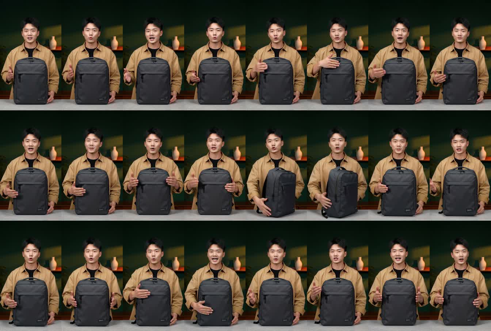

# TaoMate-H3 Metal

### 让你的 Mac，生成有声有画的一分钟。

**写下台词、动作和场景，让 Apple Silicon 在本机生成音视频。**
MiniMax H3 底模、官方 TaoMate-H3 三步 LoRA，由
[OpenCraft AI Lab](https://github.com/OpenCraft-AI-Lab) 带到 Metal/MPS。

[](https://github.com/OpenCraft-AI-Lab/taomate-h3-metal/actions/workflows/ci.yml)
[](#安装)
[](docs/METAL_PORT.md)

**[立即开始](#安装)** · **[复现官方示例](#在-metal-上复现官方示例)** · **[与 h3.c 对比](#与-h3c-比速度也比内存)** · [English](README.md)

| 一分钟，实机跑通 | 768p，少等几个小时 | 声音与画面，本机生成 |
| --- | --- | --- |
| **60 秒 480p 输出已完成**，使用官方中文背包讲解提示词。 | 两组 20 秒场景实测，**完成速度为固定版本 h3.c 的 4.1–4.2 倍**。 | 通过 **PyTorch Metal/MPS** 使用 Apple GPU，Python 流程可查看、可修改。 |



*这一分钟，来自一次完整的本机生成。抽样画面中，讲解者、背包和摄影棚保持可辨认。
[按步骤复现这个示例](#在-metal-上复现官方示例)。*

## 把创作流程，搬到你的 Mac

- **一句提示词，写完整个场景。** 台词、动作、环境声都能写进提示词，输出包含生成音画的 MP4。
- **让故事继续。** 五秒一段，利用 clean KV 历史接续；默认路径已跑通 5、10、60 秒 480p 输出。
- **把分辨率往上推。** 可选量化路径已完成原生 1088×1920 的五秒、十秒视频，
  [实测记录可查](docs/METAL_EXPANDED_WEIGHT_QUANTIZATION.md)。
- **掌握自己的流程。** 本机运行、查看配置与指标，还能尝试 W8A16 权重、INT8 KV 和工作区优化。

这是基于官方 [TaoMate-H3](https://github.com/TaoLiveAIGC/TaoMate-H3) 的独立实验性移植版。
保留训练好的 LoRA、Base10 音频 teacher、Stage3 调度和 CPU 随机噪声，也保留 CUDA 入口。
**实测机器为 M5 Max / 128 GiB 统一内存。** 其他 Mac 和小内存配置尚未验证；生成尚未达到
实时，也尚未验证 CUDA 数值对齐或独立口型同步指标。

## 与 h3.c 比速度，也比内存

**同样是 20 秒 768p 视频：约 51–53 分钟，对比约 3.5–3.7 小时。**
两组场景中，TaoMate 的完成时间约为
[antirez/h3.c 固定版本](https://github.com/antirez/h3.c/tree/8974cc055ea9c02fcd14cc27dfda3e1027c05153) 的四分之一。

测试在同一台 M5 Max / 128 GiB 上串行执行；每个场景使用相同完整提示词、seed **8304**、
**1344×768 / 24 fps**。总耗时包含 TaoMate 每个场景新生成的 Base10 teacher、生成、解码和
进程内媒体输出。内存为内核报告的**进程物理内存峰值**，TaoMate 取串行 teacher 与生成阶段
中的较大值。

| 20 秒场景 | TaoMate 总耗时 | h3.c 总耗时 | h3.c / TaoMate 时间比 | TaoMate 峰值 | h3.c 峰值 |
| --- | ---: | ---: | ---: | ---: | ---: |
| 自动玻璃工坊 | **52 分 49 秒** | 3 小时 41 分 42 秒 | **4.20×** | 64.82 GiB | **43.50 GiB** |
| 轨道货船对接 | **50 分 53 秒** | 3 小时 28 分 27 秒 | **4.10×** | 64.87 GiB | **43.52 GiB** |

**这两组测试，TaoMate 更快，h3.c 更省内存。** TaoMate 的进程内存峰值约高 49%。
根据机器容量和等待时间，选择适合你的取舍。

这是使用**可选 W8A16 / INT8 KV 配置**的历史流程对比，与下面的默认 quickstart 配置不同，
也不是等画质或纯后端对比。TaoMate 接续四个五秒 request，h3.c 对整段去噪；h3.c 固定快照
使用了有记录的两行帧数上限补丁，支持 20 秒输出（481 帧，TaoMate 为 480 帧）。每场景每个
引擎只跑一次；采样、量化与 LoRA 不同，抽样中叙事遵循程度也有差异，不宣称普遍四倍提速。
见[精确数据、参数、提示词及测试方法](docs/H3C_COMPARISON.md)。

## 安装

需要支持 MPS 的 Apple Silicon Mac、Python 3.11，以及含 libx264 / AAC
编码器的 FFmpeg 和 FFprobe。Metal 的版本约束面向 Python 3.11；继承的 CUDA 入口也接受
Python 3.10。已验证环境使用 Python 3.11、PyTorch 2.14.1、
torchvision 0.29.1，具体版本记录在 constraints 文件中。

默认 BF16/FP32 路径在 480p 的进程物理内存峰值约 **98–100 GiB**；上表约 65 GiB
使用了可选量化配置。请为系统和其他应用预留容量，128 GiB 是目前验证过的整机配置。

```sh
git clone https://github.com/OpenCraft-AI-Lab/taomate-h3-metal.git
cd taomate-h3-metal
python3.11 -m venv .venv
source .venv/bin/activate
python -m pip install --upgrade pip
python -m pip install -e '.[metal]' -c requirements/metal-constraints.txt
brew install ffmpeg
python -m taomate_h3 --help
```

MPS 不需要 CUDA、Triton、FlashAttention 或 vLLM。包名是 `taomate-h3-metal`，
Python 模块名仍为 `taomate_h3`。

## 准备模型

使用或分发前请阅读 [MiniMax H3 Community License](LICENSE)。它含地域及用途限制，
并非 MIT / Apache 许可证。模型和生成视频不随仓库分发。
底模约 135 GiB，adapter 约 2.4 GiB，还需预留输出及临时数据空间。
以下固定版本与实测一致；已有完整下载可直接复用。

```sh
hf download MiniMaxAI/MiniMax-H3 \
  --revision 42ed227ee7df40d41602854ae760620d6eb651fe \
  --include 'model_index.json' 'FL2VA/*' \
  --local-dir models/MiniMax-H3
hf download TaoLiveAIGC/TaoMate-H3 \
  --revision 7d7a51f3e63972138882ec2f0e4d1d47728110cf \
  --include 'config.json' 'adapter_config.json' 'adapter_model.safetensors' \
  --local-dir models/TaoMate-H3
```

底模必须包含 `FL2VA/video_vae/*.py` 和 `FL2VA/audio_vae/*.py`，不能只下载权重。
需要访问权限时用 `hf auth login` 登录。省略 `--adapter` 时首次运行会下载官方 adapter。

## 生成第一个视频

在仓库根目录、已激活的环境中运行：

```sh
PYTORCH_ENABLE_MPS_FALLBACK=0 python -m taomate_h3 \
  --backend mps \
  --model-root models/MiniMax-H3 --adapter models/TaoMate-H3 \
  --prompt 'A calm ocean at sunrise, gentle waves washing onto a sandy beach.' \
  --duration 5 --resolution 864x480 --seed 1 \
  --output outputs/ocean-5s
```

输出目录必须不存在或为空，结果为 `video.mp4`，附配置及运行指标 JSON。
必须显式传 `--backend mps`；继承的默认值仍是 `cuda`。MPS 使用一个本地进程，
`--devices`、`--gpus` 是 CUDA 参数。最终 latent 与可播放视频是不同的交付阶段。

## 在 Metal 上复现官方示例

先完成上面的环境安装和固定版本模型下载。仓库中的两个提示词文件与上游版本
`6b2f9984acf681e2f387188f5d1f3b26e504315b` 完全一致，也与我们的实测输入一致。
它们生成的是背包讲解者的中文口播示例。

| 示例 | 官方提示词文件 | 五秒 request 数 | 分辨率 | 每个 request 的 seed |
| --- | --- | ---: | --- | ---: |
| 10 秒 | [`prompts_10s.json`](examples/prompts_10s.json) | 2 | 480×864 竖屏 | 8301 |
| 60 秒 | [`prompts_60s.json`](examples/prompts_60s.json) | 12 | 480×864 竖屏 | 8301 |

使用没有遗留 `TAOMATE_MPS_*` 实验选项的新终端，激活 `.venv`，在仓库根目录运行。
下面使用默认 BF16/FP32 路径，内存水位参数与实测一致。

**10 秒示例：**

```sh
PYTORCH_ENABLE_MPS_FALLBACK=0 \
PYTORCH_MPS_HIGH_WATERMARK_RATIO=0.9 \
PYTORCH_MPS_LOW_WATERMARK_RATIO=0.8 \
python -m taomate_h3 \
  --backend mps --model-root models/MiniMax-H3 --adapter models/TaoMate-H3 \
  --prompt-json examples/prompts_10s.json \
  --duration 10 --resolution 480x864 --seed 8301 \
  --output outputs/official-example-10s
```

**60 秒示例：**

```sh
PYTORCH_ENABLE_MPS_FALLBACK=0 \
PYTORCH_MPS_HIGH_WATERMARK_RATIO=0.9 \
PYTORCH_MPS_LOW_WATERMARK_RATIO=0.8 \
python -m taomate_h3 \
  --backend mps --model-root models/MiniMax-H3 --adapter models/TaoMate-H3 \
  --prompt-json examples/prompts_60s.json \
  --duration 60 --resolution 480x864 --seed 8301 \
  --output outputs/official-example-60s
```

10 秒 JSON 显式指定两个 seed；60 秒 JSON 的十二个 request 均使用 `--seed 8301`。
对照实测时保留完整提示词，包括台词及 soundscape。输出分别是
`outputs/official-example-10s/video.mp4` 和 `outputs/official-example-60s/video.mp4`；
重跑时换一个新的输出目录。

在实测 M5 Max / 128 GiB 上，整条命令（含 teacher）生成十秒耗时约 10 分 16 秒，
生成一分钟耗时约 55 分 26 秒，进程物理内存峰值约 98–100 GiB。
Metal 复现已验证完整媒体解码及抽样画面的连续性，尚未验证与官方 CUDA 视频逐像素或
逐张量一致。详见[实测记录](docs/METAL_PORT.md#completed-full-pipeline-runs)。

## 自定义提示词与分辨率

JSON 为 `{"prompts": ["前五秒", "后五秒"], "seeds": [8301, 8301]}`。
时长须为正的五秒倍数，与提示词数量一致；`--prompt` 和 `--prompt-json` 互斥。
分辨率写作 `宽x高`，两边须为 32 的倍数，短边为 480、768 或 1088。
常见横屏为 `864x480`、`1376x768`、`1920x1088`，交换宽高即竖屏。
1088 是对齐的原生 1080p 级边长，需要精确 1080 时生成后裁剪。
支持参数解析不代表对应分辨率能在所有机器运行。

## 实测与限制

默认路径的历史实测（M5 Max / 128 GiB，时间含 teacher）：

| 输出 | 整条命令耗时 | 进程物理内存峰值 |
| --- | ---: | ---: |
| 864×480，5 秒 | 320.114 秒 | 97.76 GiB |
| 480×864，10 秒 | 616.452 秒 | 98.20 GiB |
| 480×864，60 秒 | 3,325.502 秒 | 99.63 GiB |

这些输出通过完整 FFmpeg 解码和音频有限值检查；一分钟视频抽样保留相同的讲解者、
背包与场景。它们验证运行和媒体交付，未验证 CUDA 数值一致、语音文本准确度或口型同步。
数据对应记录中的代码版本，并非每次后续修改重新跑出的结果。

后续量化实验完成原生 1088×1920 的五秒、十秒输出；FC2 的 65 秒实验遇到分配器限制，
组合量化 65 秒实验在完成前被停止。没有宣称原生 1080p 的 65 秒成功，也未验证完整模型
跨第 13 个 request 的音频 reset。见[量化实测](docs/METAL_EXPANDED_WEIGHT_QUANTIZATION.md)。

W8A16 权重与 INT8 KV 有损，可能改变细节、姿态及构图，不等于 CUDA W8A8，也没有
证明普遍提速。选项须显式启用，详见[内存实验](docs/METAL_MEMORY_EXPERIMENTS.md)。
长任务可使用 macOS 内存监测及守护脚本，命令见 [CONTRIBUTING.md](CONTRIBUTING.md)。

## 开发与来源

```sh
python -m pip install -e '.[metal,test]' -c requirements/metal-constraints.txt
ruff check src scripts tests
python -m pytest -q
```

普通测试用小张量，不下载模型；没有 MPS 时跳过 GPU 测试。macOS 监测程序自动编译到
测试临时目录。两个可选 publication 测试需要官方 processor 源码，可通过
`TAOMATE_TEST_MODEL_ROOT` 指定路径。CI 检查 CPU 合约、lint 和打包，不代替真实 MPS 验证。

官方 TaoMate-H3 来自 Alibaba TaoLive AIGC Team，底模来自 MiniMax H3。
OpenCraft 增加 Apple Silicon 后端、内存优化、测试和发布文档。固定上游版本为
`6b2f9984acf681e2f387188f5d1f3b26e504315b`。
详见[文档索引](docs/README.md)、[修改说明](MODIFICATIONS.md)、[版本记录](CHANGELOG.md)
及 [LICENSE](LICENSE) / [NOTICE](NOTICE)。
